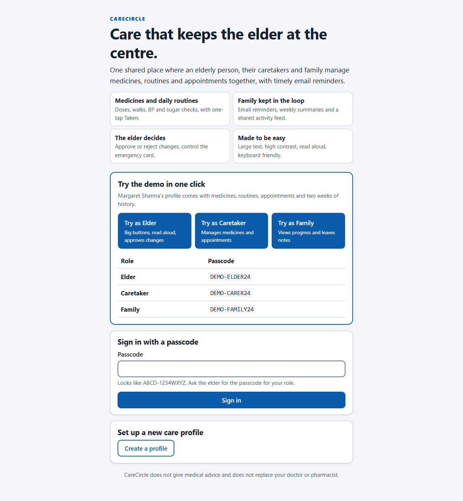
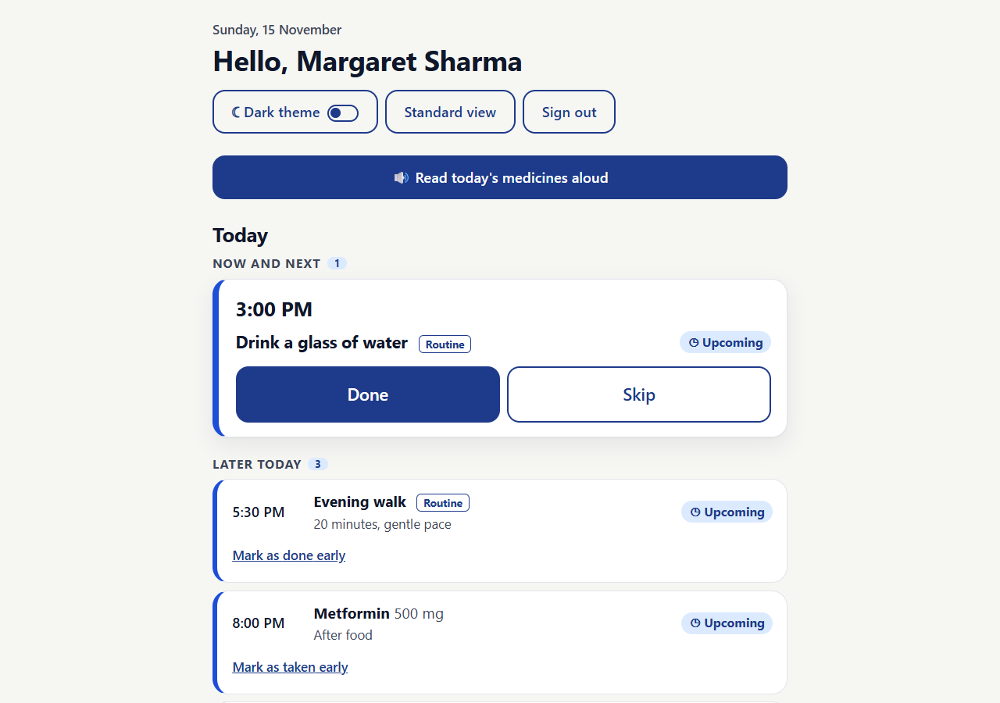
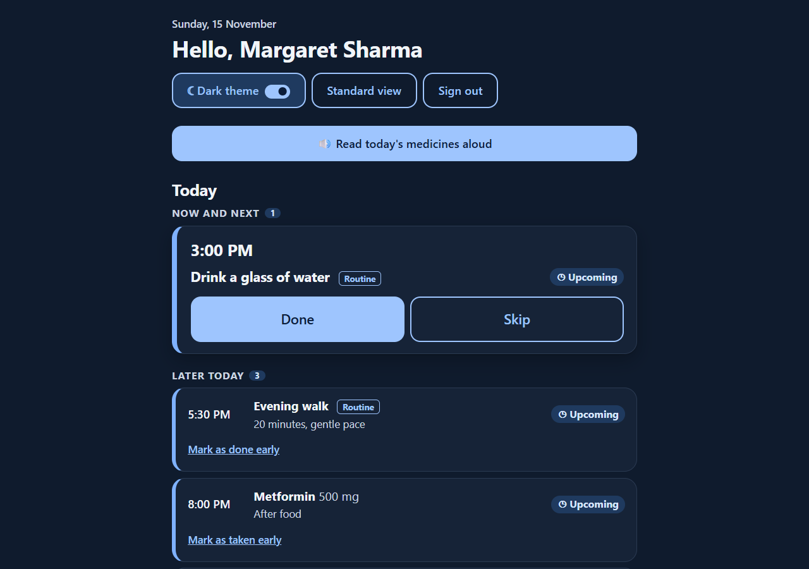
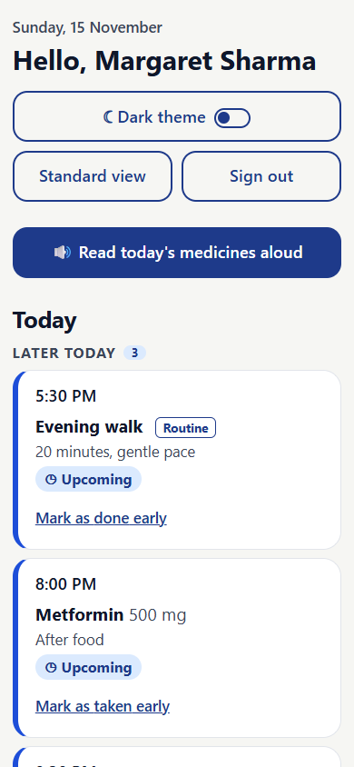
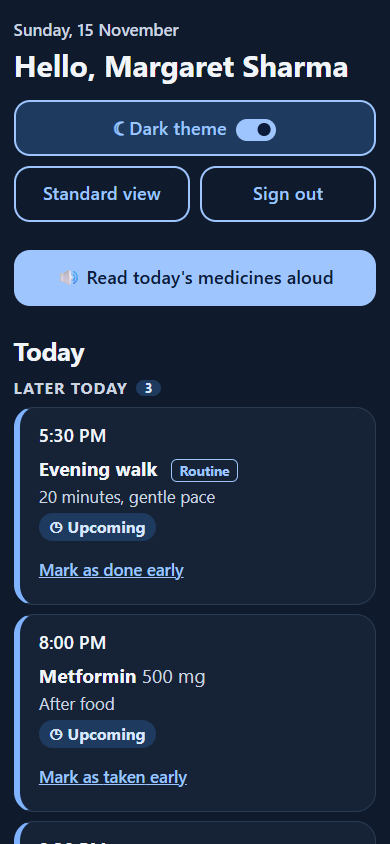
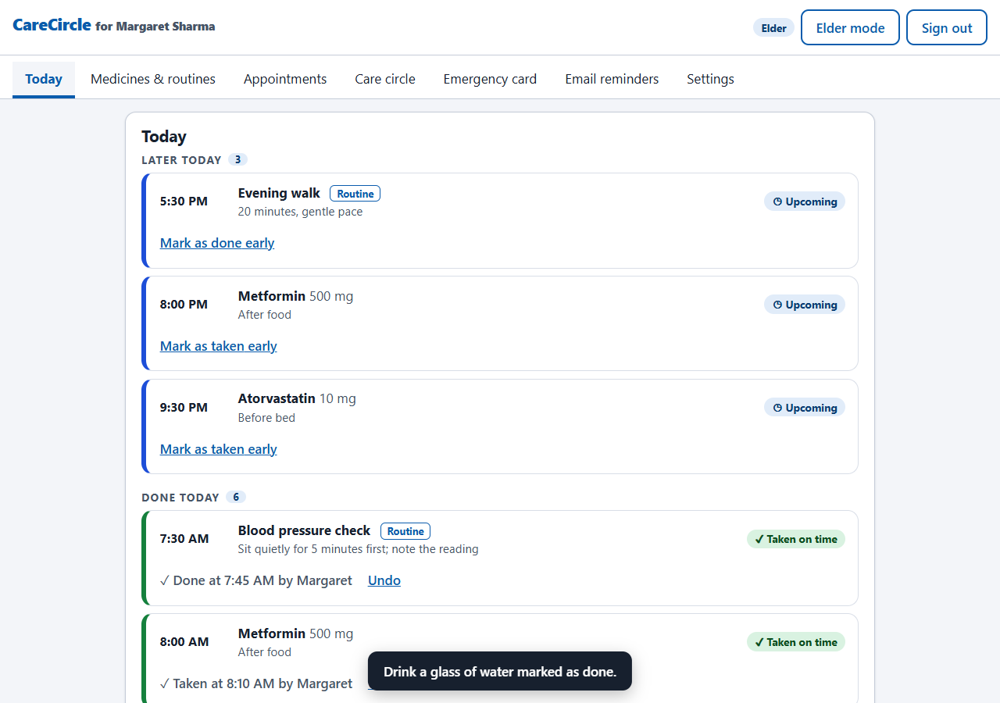
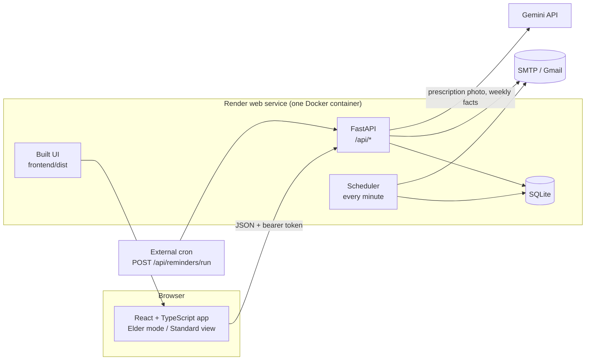

# CareCircle

**Live app: https://carecircle-d9ia.onrender.com**
(Free hosting sleeps when idle, so the first load can take about 30 seconds.)

> CareCircle does not give medical advice and does not replace a doctor or pharmacist.

**Shared, elder-first care for the people we love.** One shared healthcare profile where an elderly person, their
caretakers and their family manage medicines, daily routines and doctor appointments together, with proactive email
reminders, while the elder stays at the centre of every decision.



## Demo guide (60 seconds)

The landing page has three one-click buttons, or sign in manually with these passcodes (profile: Margaret Sharma,
with two weeks of history):

| Role      | Passcode        | What this role can do                                                          |
|-----------|-----------------|--------------------------------------------------------------------------------|
| Elder     | `DEMO-ELDER24`  | Everything, approve or reject others' changes, control the emergency card, rotate passcodes |
| Caretaker | `DEMO-CARER24`  | Add/edit medicines, routines and appointments, mark doses, manage reminder contacts |
| Family    | `DEMO-FAMILY24` | View everything, leave notes. Cannot edit anything                              |

1. **Try as Elder**: Elder mode opens with big buttons. Tap *Done*/*Taken*, try *Read today's medicines aloud*, answer
   *How are you feeling today?*, open *My emergency card*.
2. Switch to *Standard view*: **Today** (adherence, 7-day chart, per-medicine %), **Medicines & routines**,
   **Appointments**, **Care circle** (AI weekly summary, notes, activity feed), **Emergency card** (*Show to doctor* and
   print), **Email reminders** (demo outbox), **Settings**.
3. In **Settings** turn on *Require the elder's approval*, then **Try as Caretaker** in another browser and add a
   medicine: it appears as *pending elder approval* until the elder approves it.
4. In **Settings** use *Send a test email* to see a real email (when SMTP is configured on the server).
5. **Try as Family**: everything is view-only (no Taken/Skip, no Add buttons).

| Elder mode (light, default) | Elder mode (dark theme) |
|---|---|
|  |  |

| Elder mode on a phone (light) | Elder mode on a phone (dark) | Today view |
|---|---|---|
|  |  |  |

Full-length pages: [Elder light](docs/screenshots/02-elder-light-full.png), [Elder dark](docs/screenshots/02-elder-dark-full.png),
[Today](docs/screenshots/03-standard-today.png).

More: [emergency card](docs/screenshots/03-standard-emergency-card.png),
[show to doctor](docs/screenshots/04-show-to-doctor.png), [settings](docs/screenshots/03-standard-settings.png),
[email reminders](docs/screenshots/03-standard-email-reminders.png).

## Problem

Older adults often take several medicines at different times, attend regular appointments, and rely on relatives who
live elsewhere. Basic reminder apps only beep. They do not tell the family when a dose is missed, do not track
adherence, do not cover routines such as BP checks or walks, and rarely let the elder stay in control. CareCircle
gives the whole circle a shared view, proactive emails, and puts the elder's choices first.

## Features

* **Passcode-based shared access.** One passcode per role (Elder, Caretaker, Family), stored only as bcrypt hashes.
  Wrong guesses are rate-limited with a temporary lockout; sessions expire and can be logged out. The elder (or a
  caretaker, for the family passcode) can **rotate or turn off** a passcode, which also signs that role out.
* **Medicines and healthcare routines.** Doses, times per day, start/end dates, instructions, stock. Routines
  (BP/sugar checks, walks, water, physiotherapy) use the same schedule, reminders and adherence. Archive instead of
  delete so history is kept. A **duplicate-medicine warning** asks for confirmation before adding the same name twice.
* **Adherence.** Every dose is *on time*, *late*, *skipped* or *missed*; weekly %, a 7-day chart and per-medicine %.
* **Appointments** with doctor, place, time, notes and an upcoming list.
* **Email reminders that work.** Upcoming dose, missed dose (30 minutes, to caretakers and family), appointment (1 day
  and 2 hours before), routine reminders, low stock, and wellbeing alerts. HTML + plain text, large text, the elder's
  name and a link back to the app. Idempotent (a unique key per reminder), IST-aware, retried with backoff on SMTP
  failure, and failures never crash the app. Each member chooses which emails they get.
  Without SMTP, the **demo outbox** shows every email with its status.
* **The elder at the centre.** *Require my approval* makes caretaker edits **pending elder approval**. The elder sees
  every change in the activity log, controls the emergency card, and can answer a daily check-in with one tap.
* **Emergency information card** (blood group, allergies, conditions, doctor, contacts, current medicines auto-filled)
  with a full-screen *Show to doctor* view and a print button. Only the elder can edit it.
* **Daily wellbeing check-in**: Good / Okay / Not well plus an optional note, visible to the family; two "not well"
  answers in a row email the caretakers.
* **AI with Gemini (optional, never medical advice):** a prescription photo becomes a **draft** a human must review and
  confirm, and a plain-language weekly family summary with a non-AI fallback.
* **Elder mode:** calm light theme by default (off-white, near-black, deep blue) with an optional soft dark navy theme,
  very large text, WCAG AAA contrast in both themes, doses grouped into *Now and next*, *Later today* and *Done today*,
  status shown by a slim coloured border + icon + text, big Taken/Skip buttons only for what is due, a calm
  "Taken at 8:02 AM by Margaret" line with *Undo* once done, and *Read aloud* with the Web Speech API.

## Requirements traceability

| # | Requirement from the challenge | Feature | Main file | Test |
|---|---|---|---|---|
| R1 | Manage daily medications | Medicine CRUD, archive, stock | `backend/app/routers/core.py`, `services/changes.py` | `test_api.py::test_medication_crud_and_activity_log` |
| R2 | Healthcare routines | `kind = routine` with the same schedule/adherence | `schemas.py::MedicationIn`, `services/reminders.py` | `test_features.py::test_routine_*` |
| R3 | Medical appointments, upcoming list | Appointment CRUD | `routers/core.py` | `test_api.py::test_appointments_upcoming_and_validation` |
| R4 | Keep family and caretakers informed | Emails, activity feed, notes, weekly summary, per-member preferences | `services/reminders.py`, `routers/core.py` | `test_features.py::test_contact_preferences_*` |
| R5 | Shared ecosystem (elder, caretaker, family) | One profile, three roles | `permissions.py` | `test_api.py::test_permission_matrix_for_edits` |
| R6 | Secure passcode access | bcrypt, rate limit + lockout, token expiry, logout, rotate/revoke | `security.py`, `services/profiles.py`, `routers/extras.py` | `test_auth.py`, `test_features.py::test_*passcode*` |
| R7 | View | All roles can view | `permissions.py` | `test_api.py::test_family_can_view_and_comment_only` |
| R8 | Add, edit, manage | Full CRUD, validation, duplicate guard, approvals | `services/changes.py` | `test_api.py`, `test_features.py::test_duplicate_*` |
| R9 | Track adherence | Per-dose status, weekly %, trend, per medicine | `services/adherence.py` | `test_adherence.py`, `test_features.py::test_weekly_trend_*` |
| R10 | Upcoming appointments | Upcoming list, elder-mode next visit | `routers/core.py` | `test_api.py` |
| R11 | Email: upcoming doses | 15-minute window reminder | `services/reminders.py` | `test_reminders.py::test_upcoming_dose_*` |
| R12 | Email: missed medications | 30 minutes, caretakers + family | `services/reminders.py` | `test_reminders.py::test_missed_dose_*` |
| R13 | Email: appointments | 1 day and 2 hours before | `services/reminders.py` | `test_reminders.py::test_appointment_windows` |
| R14 | Emails reliably sent | SMTP/Gmail STARTTLS, HTML + text, retries, test button | `services/mailer.py`, `routers/extras.py` | `test_features.py::test_gmail_style_*`, `test_*retry*` |
| R15 | Smarter | Prescription AI draft, AI summary, emergency card, check-ins, duplicate warning | `services/ai.py`, `routers/ai.py`, `routers/extras.py` | `test_ai.py`, `test_features.py` |
| R16 | More accessible | Elder mode, read aloud, AAA contrast, axe + contrast tests | `frontend/src/components/ElderMode.tsx`, `styles.css` | `frontend/src/App.test.tsx`, `src/test/contrast.test.ts` |
| R17 | More reliable | Idempotent reminders, retries, CI, 96% coverage | `services/mailer.py`, `.github/workflows/ci.yml` | `test_reminders.py`, `test_features.py` |
| R18 | More collaborative | Notes, activity feed, notification preferences | `routers/core.py` | `test_features.py::test_contact_preferences_*` |
| R19 | Elder at the centre | Approval gate, elder-only emergency card, check-ins, passcode control | `services/changes.py`, `routers/extras.py` | `test_api.py::test_approval_workflow`, `test_features.py::test_emergency_*` |

## Architecture



```
backend/app/
  main.py          app factory, security headers, error format, scheduler, serves frontend/dist
  routers/         core.py (profiles, meds, doses, appointments, activity, contacts, outbox)
                   extras.py (passcodes, test email, emergency card, check-ins)
                   reminders.py (cron endpoint), ai.py (Gemini endpoints)
  services/        adherence.py, changes.py (CRUD + approval gate + activity log), reminders.py (rules),
                   mailer.py (HTML/text, SMTP, retries), profiles.py, ai.py, seed.py
  permissions.py   role -> permission matrix and FastAPI dependencies   security.py  bcrypt, tokens, rate limiter
  schemas.py       Pydantic models    db.py  SQLite schema + migrations    clock.py  timezone helpers
frontend/src/      App.tsx, api.ts, components/*, test/* (mock API, axe helper, contrast tests)
```

Times are stored as local wall-clock time in the elder's timezone (default `Asia/Kolkata`).

## How AI is used (and its safeguards)

* Gemini is called only from the backend; the API key never reaches the browser or the logs.
* **Prescription reader:** the photo goes to Gemini, which must return JSON. The reply is validated with a Pydantic
  schema; frequencies are mapped to default times in our code; the result is only a **draft** shown in an editable
  form. Nothing is saved until a person presses *Confirm and save*, which uses the normal permission-checked endpoint.
  Uploads are limited to 5 MB and checked by file signature, and the prompt tells the model to ignore instructions
  inside the image.
* **Weekly summary:** the numbers are computed in Python; Gemini only rewords those facts. The prompt forbids advice,
  the output is schema-validated, and results are cached for 6 hours.
* **Failure handling:** if AI is not configured, errors, is rate-limited (10 calls/hour per profile) or returns invalid
  output, the UI shows a clear message; manual entry still works and the summary falls back to a plain computed text.
* A visible note on the login page, footer, AI screens and emails says the app is not medical advice.

## Accessibility

Semantic landmarks and one `h1` per view, a skip link, a label for every input, visible focus, 44 px targets, status
shown with icon + text + colour, `aria-live` messages, an accessible 7-day chart with a hidden data table, focus moved
into the full-screen doctor view and `Escape` closes it, `lang="en"`, responsive down to phone width,
`prefers-reduced-motion` respected, and text that scales with the browser font size.
Elder mode is WCAG **AAA** in both themes (every text pair at 7:1 or better, status colours 3:1 or better, checked by tests).
Verified three ways: **axe-core in unit tests** on every screen (`npm test`), a **real-browser run** (Edge via
Playwright, `npm run e2e`) with axe including colour contrast on 12 views as each role (0 violations, 0 console errors),
and **computed contrast tests** for the CSS tokens. See `AUDIT.md`.

## Security

* bcrypt passcodes; session tokens stored only as SHA-256; expiry (`SESSION_TTL`); passcodes can be rotated or turned off.
* Rate limits: wrong passcodes (per client+profile and per profile, with `Retry-After`), profile creation, AI calls,
  test emails. Photo uploads: size and type limits.
* Pydantic validation on every body (`extra="forbid"`, length/range limits); parameterised SQL everywhere.
* Every endpoint checks the role's permission; a session is bound to one profile and endpoints never take a profile id,
  so one profile cannot read another (tested).
* CORS restricted to `CORS_ORIGINS`; CSP, `X-Content-Type-Options`, `X-Frame-Options`, `Referrer-Policy`;
  `Cache-Control: no-store` on the API.
* `/api/reminders/run` needs a secret token (constant-time compare) and is off when none is configured.
* Secrets only from environment variables; `.env` is git-ignored (GitHub push protection is on); logs never contain
  keys or email content. Demo addresses (`example.com`) are never sent to a real mail server.
* Pinned dependencies; `pip-audit` clean; `npm audit --omit=dev` clean (CI runs both).

## Setup

```bash
python -m venv .venv
.venv/Scripts/pip install -r backend/requirements-dev.txt     # Linux/macOS: .venv/bin/pip
cp .env.example .env                                           # fill in what you need
cd frontend && npm install && npm run build && cd ..
cd backend && ../.venv/Scripts/python -m uvicorn app.main:app --port 8000   # http://localhost:8000
```

For hot-reload UI work run `npm run dev` in `frontend/` (it proxies `/api` to port 8000).

### Environment variables (see `.env.example`)

| Variable | Purpose |
|----------|---------|
| `GEMINI_API_KEY`, `GEMINI_MODEL` | Enable AI features (optional) |
| `SMTP_HOST`, `SMTP_PORT`, `SMTP_USER`, `SMTP_PASSWORD`, `FROM_EMAIL`, `SMTP_USE_TLS` | Real email. Unset = demo outbox. Gmail: `smtp.gmail.com`, 587, an app password |
| `REMINDER_TOKEN` | Secret for `POST /api/reminders/run` |
| `APP_TIMEZONE` | Default timezone (`Asia/Kolkata`) |
| `APP_URL` | Link shown in emails |
| `CORS_ORIGINS` | Allowed origins |
| `SESSION_TTL` | Session lifetime in hours |
| `DATABASE_PATH`, `BCRYPT_ROUNDS`, `DISABLE_SCHEDULER` | Storage and tuning |

## Tests and coverage

```bash
cd backend && ../.venv/Scripts/python -m pytest --cov=app          # 98 tests, 96% coverage (CI requires >= 90%)
cd backend && ../.venv/Scripts/ruff check . && ../.venv/Scripts/ruff format --check . && ../.venv/Scripts/mypy app
cd frontend && npm run lint && npm run format:check && npm test && npm run build     # 70 tests incl. axe + AAA contrast (both themes)
cd frontend && npm run e2e -- http://localhost:8000                # real-browser click-through (needs Edge/Chrome)
```

GitHub Actions runs lint, types, tests with the coverage gate, the frontend build and dependency audits on every push.

## Deployment

`render.yaml` defines one Docker web service (the Dockerfile builds the React app, then serves it from FastAPI).
Add `GEMINI_API_KEY` and the SMTP variables in the Render dashboard. The free disk is ephemeral, so the demo profile is
re-seeded on each start.

**Reminders while the free server sleeps (cron-job.org):**
1. Create a free account at cron-job.org and a new cron job.
2. URL: `https://carecircle-d9ia.onrender.com/api/reminders/run`, method **POST**, schedule every 5 minutes.
3. Under *Advanced > Headers* add `X-Reminder-Token` with the value of `REMINDER_TOKEN` from the Render environment.
4. Save. The job wakes the server and sends any due reminders (each is sent once).

## Limitations

SQLite on the free instance is not durable; the rate limiter is in memory (single worker); AI output can be wrong,
which is why a person always confirms it.

## License

MIT, see `LICENSE`.
